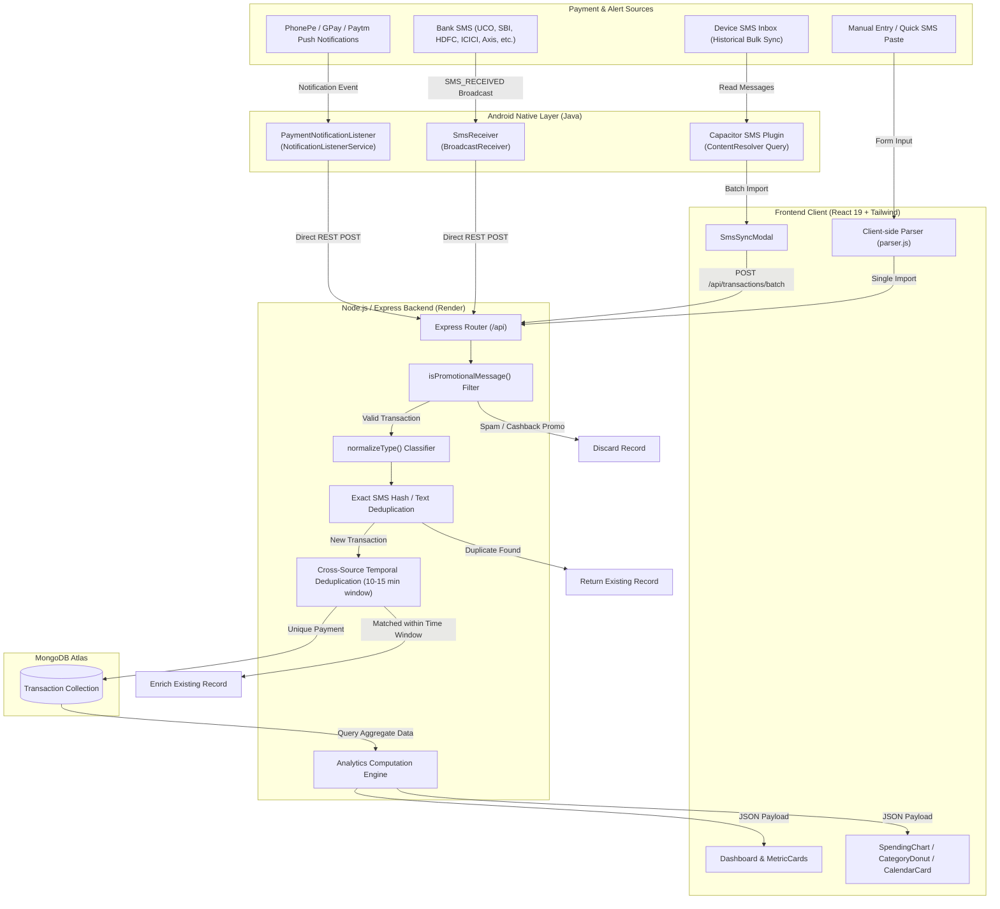
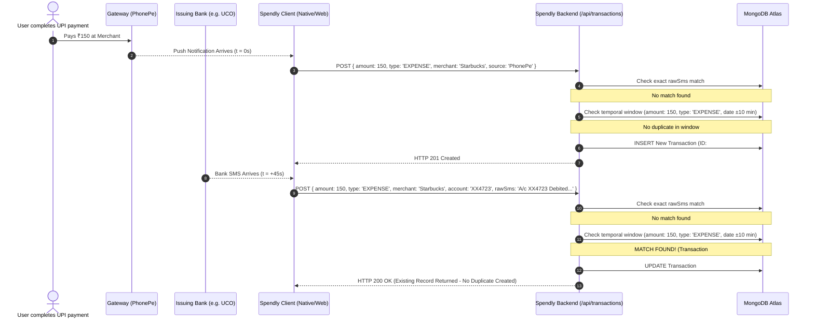

# Spendly System Architecture & Technical Specification

> **Spendly** is an automated, zero-manual expense and UPI tracking platform built specifically for the Indian digital payment ecosystem. It intercepts real-time transactions from SMS and push notifications, executes heuristic extraction and cross-source deduplication, and renders live financial analytics across mobile and web interfaces.

---

## Table of Contents

1. [High-Level Architecture](#1-high-level-architecture)
2. [Component Diagram & Data Flow](#2-component-diagram--data-flow)
3. [Client Layer (Web & Mobile Runtime)](#3-client-layer-web--mobile-runtime)
4. [Native Android Telemetry & Interception](#4-native-android-telemetry--interception)
5. [Heuristic Parser & Categorization Engine](#5-heuristic-parser--categorization-engine)
6. [Ingestion Pipeline & Smart Deduplication](#6-ingestion-pipeline--smart-deduplication)
7. [Backend API & Service Layer](#7-backend-api--service-layer)
8. [Database Schema & Aggregation Pipeline](#8-database-schema--aggregation-pipeline)
9. [Security, Privacy & Edge Computing](#9-security-privacy--edge-computing)
10. [Deployment & Infrastructure](#10-deployment--infrastructure)

---

## 1. High-Level Architecture

Spendly employs a **hybrid client-edge architecture** combined with a **centralized cloud aggregation backend**. The platform consists of three core functional tiers:

```
┌────────────────────────────────────────────────────────────────────────┐
│                      1. Edge & Mobile Layer                            │
│  ┌───────────────────────┐  ┌───────────────────────────────────────┐  │
│  │   Android Native OS   │  │       Hybrid Client (Capacitor)       │  │
│  │  - SmsReceiver        │  │  - React 19 Single Page App           │  │
│  │  - NotificationListen │  │  - Tailwind CSS Neo-morphic UI        │  │
│  │  - Device Inbox Sync  │  │  - Client-side Parser & Preview       │  │
│  └───────────┬───────────┘  └───────────────────┬───────────────────┘  │
└──────────────┼──────────────────────────────────┼──────────────────────┘
               │  HTTP REST (JSON)                │
               ▼                                  ▼
┌────────────────────────────────────────────────────────────────────────┐
│                      2. API Gateway & Services                         │
│  ┌──────────────────────────────────────────────────────────────────┐  │
│  │              Node.js (Express 5) Service on Render               │  │
│  │  - REST API Routing (/api/transactions, /api/analytics)          │  │
│  │  - Anti-Spam / Promotional Text Filtering                        │  │
│  │  - Heuristic Normalizer & Category Resolver                      │  │
│  │  - 10-15 Min Sliding Window Cross-Source Deduplicator            │  │
│  └──────────────────────────────────┬───────────────────────────────┘  │
└─────────────────────────────────────┼──────────────────────────────────┘
                                      │ Mongoose ODM
                                      ▼
┌────────────────────────────────────────────────────────────────────────┐
│                   3. Persistence & Analytics Layer                     │
│  ┌──────────────────────────────────────────────────────────────────┐  │
│  │                    MongoDB Atlas Cloud Cluster                   │  │
│  │  - Indexed Document Store (`Transaction` Collection)             │  │
│  │  - Real-Time Dynamic In-Memory Aggregations                      │  │
│  │  - Monthly Cashflow, Category Donut & Daily Matrix Computations  │  │
│  └──────────────────────────────────────────────────────────────────┘  │
└────────────────────────────────────────────────────────────────────────┘
```

---

## 2. Component Diagram & Data Flow

### 2.1 Complete End-to-End Pipeline



---

## 3. Client Layer (Web & Mobile Runtime)

The frontend is packaged as both a standalone responsive Web Application and an Android APK bundled through Capacitor.

### 3.1 Technology Composition
- **Framework**: React 19 (Functional Components, Hooks)
- **Bundler & Tooling**: Vite 8
- **Styling**: Tailwind CSS 3.4 (with custom neo-morphic utility layer and `@layer utilities` scrollbar controls)
- **Iconography**: Lucide React
- **Micro-Animations**: Canvas Confetti, CSS keyframe donut sweep animations

### 3.2 Presentation Modules
1. **MetricCards (`MetricCards.jsx`)**:
   - Displays key financial indicators: Total Expense, Total Income / Revenue, PhonePe & UPI Spend, and Daily Average Spend.
   - Dual-section architecture:
     - **This Month Overview**: Dynamically computed for the current calendar month.
     - **Lifetime Overview**: Collapsible accordion (closed by default) tracking historical totals.
2. **SpendingChart (`SpendingChart.jsx`)**:
   - Horizontally scrollable dual bar chart showing month-over-month expenses.
   - Auto-scrolls to the active month with hover/tap currency tooltips.
3. **CategoryDonut (`CategoryDonut.jsx`)**:
   - Visual distribution of expenses across 9 standardized spending categories.
   - SVG stroke-dasharray animation calculating percentage share and category totals.
4. **CalendarCard (`CalendarCard.jsx`)**:
   - Interactive month-by-month spending calendar.
   - Multi-month navigation (`ChevronLeft` / `ChevronRight`) with strict month isolation to avoid data bleed.
   - Visual indicators displaying combined daily debit (`-₹Amount`) and credit (`+₹Amount`) movements.
5. **SmsSyncModal (`SmsSyncModal.jsx`)**:
   - Real-time client-side regex parsing playground.
   - Sample pill selector for quick testing of UCO Bank, PhonePe, SBI, and HDFC message formats.
   - One-tap Android device inbox sync trigger.

---

## 4. Native Android Telemetry & Interception

Spendly runs native Android background services to intercept financial signals directly at the operating system level without requiring user initiation:

```
Android OS
 ├── Telephony Subsystem
 │    └── Telephony.SMS_RECEIVED
 │         └── SmsReceiver.java
 │              ├── Extracts SMS PDU & Body
 │              ├── Runs Regex Pattern Matching
 │              └── Dispatches HTTP POST -> /api/transactions
 │
 └── Notification Subsystem
      └── NotificationListenerService
           └── PaymentNotificationListener.java
                ├── Intercepts com.phonepe.app, com.google.android.apps.nbu.paisa.user, net.one97.paytm
                ├── Extracts Notification Title, Subtext, & BigText
                └── Dispatches HTTP POST -> /api/transactions
```

### 4.1 `SmsReceiver.java`
- Registered in `AndroidManifest.xml` with priority intent filters for `android.provider.Telephony.SMS_RECEIVED`.
- Listens for SMS originating from verified sender headers (e.g., `VM-UCOBNK`, `AD-SBIINB`, `VK-HDFCBK`).
- Extracts sender, body, and timestamp, converts them into a standardized JSON payload, and posts them asynchronously to the Spendly cloud API.

### 4.2 `PaymentNotificationListener.java`
- Inherits from `NotificationListenerService`.
- Hooks into push notifications from major Indian payment gateways:
  - PhonePe (`com.phonepe.app`)
  - Google Pay (`com.google.android.apps.nbu.paisa.user`)
  - Paytm (`net.one97.paytm`)
- Captures instant debit/credit messages that arrive even when cellular SMS is delayed or disabled.

### 4.3 Capacitor Native Bridge
- Handles runtime permissions (`RECEIVE_SMS`, `READ_SMS`, `BIND_NOTIFICATION_LISTENER_SERVICE`).
- Bridges historical SMS queries using Android `ContentResolver` to allow one-click bulk ingestion of past transactions into the cloud database.

---

## 5. Heuristic Parser & Categorization Engine

The parser engine (`parser.js` in frontend, mirrored in `transactionController.js` on backend) normalizes unstructured natural language text from varied financial institutions into structured data entities.

### 5.1 Financial Entity Extraction Pipeline

```
Raw SMS / Push Notification Body
  │
  ├── 1. Anti-Spam Verification
  │     └─ Regex match on marketing keywords (e.g. "claim your cashback", "coupon", "flat 50% off")
  │        └─ Match found? -> Terminate / Return null
  │
  ├── 2. Credit vs. Debit Classification
  │     ├─ Explicit Credit Check: ("money received", "credited", "deposited", "has sent ₹... to your account")
  │     │   └─ Match? -> Type: INCOME
  │     └─ Debit Check: ("debited", "paid", "withdrawn", "spent", "purchase")
  │         └─ Match? -> Type: EXPENSE
  │
  ├── 3. Precision Amount Parsing
  │     └─ Regex: /(?:RS|INR|₹|Rs\.?)\s*([\d,]+(?:\.\d{1,2})?)/i
  │        └─ Normalizes commas ("1,250.00" -> 1250) into standard IEEE 754 float
  │
  ├── 4. Account & Reference Extraction
  │     └─ Resolves account mask regexes: /(?:A\/c|account|acct)[\s\w]*([X\d]{4,})/i
  │
  ├── 5. Merchant & Payee Extraction
  │     └─ Identifies vendor tags from "to VPA", "at <Merchant>", "transferred to <Name>"
  │
  └── 6. Automated Category Taxonomy Resolution
        └─ Maps merchant & transaction text to one of 9 domain categories
```

### 5.2 Category Taxonomy Mapping

| Category | Typical Keywords & Merchants |
| :--- | :--- |
| **Food & Dining** | Swiggy, Zomato, Starbucks, McDonald's, Burger King, Cafe, Restaurant, Bakery, Subway, Dominos, KFC, Chai |
| **Shopping & Retail** | Amazon, Flipkart, Myntra, Zara, H&M, Ajio, Tata CliQ, Nykaa, Retail, Mart, Mall, Meesho |
| **Transportation** | Uber, Ola, Rapido, Metro, Petrol, Fuel, Indian Oil, Bharat Petroleum, Shell, IRCTC, IndiGo, FASTag |
| **Bills & Utilities** | Airtel, Jio, Vi, Electricity, Bescom, Water, Gas, WiFi, Broadband, Recharge, BillDesk, DTH, Tata Sky |
| **Entertainment** | Netflix, Spotify, BookMyShow, Hotstar, Prime Video, YouTube, Cinema, PVR, INOX, Steam, PlayStation |
| **Health & Medical** | Apollo, PharmEasy, 1mg, Pharmacy, Hospital, Clinic, Medplus, Cult.fit, Gym, Doctor |
| **Saving & Investment** | Zerodha, Groww, AngelOne, Upstox, Mutual Fund, SIP, NSE, BSE, Crypto |
| **Salary & Income** | Salary, Payroll, Allowance, Bonus, Dividend, Pension |
| **UPI & Bank Transfer** | UCO, SBI, HDFC, ICICI, Axis, PNB, Canara, General P2P transfers |

---

## 6. Ingestion Pipeline & Smart Deduplication

A critical challenge in automated expense tracking is **dual-channel duplication**: when a user completes a single UPI payment via PhonePe, two notifications often arrive simultaneously:
1. An instant app push notification from PhonePe: *"Paid ₹150 to Starbucks"*
2. An SMS notification from the issuing bank: *"A/c XX4723 debited with Rs.150.00 at Starbucks..."*

To avoid double-counting, Spendly employs a **multi-stage deduplication engine**:



### Deduplication Strategies:
1. **Sanitized Raw SMS Exact Matching**:
   Normalizes whitespace and verifies if the exact message text already exists in the database.
2. **Temporal Window Match (10–15 Minutes)**:
   Queries the database for an existing transaction with:
   - Same `amount`
   - Same `type` (`EXPENSE` or `INCOME`)
   - `date` within `[currentTime - 10 min, currentTime + 10 min]`
3. **Data Enrichment on Conflict**:
   If the bank SMS arrives after the push notification, it enriches the existing record with the bank account number (`account: "XX4723"`) rather than creating a second entry.

---

## 7. Backend API & Service Layer

The backend is built with **Node.js** and **Express 5** deployed on Render. It provides RESTful endpoints designed for high availability and low latency.

### 7.1 REST Endpoints

| Method | Endpoint | Description |
| :--- | :--- | :--- |
| `GET` | `/` | HTML status health badge showing live cloud and database connectivity |
| `GET` | `/health`, `/api/health` | JSON health check returning timestamp and DB status |
| `GET` | `/api/transactions` | Retrieves all transactions sorted by date descending |
| `POST` | `/api/transactions` | Ingests a single transaction with deduplication & spam filtering |
| `POST` | `/api/transactions/batch` | Bulk transaction ingestion for historical device sync |
| `DELETE` | `/api/transactions/:id` | Deletes an individual transaction by ID |
| `DELETE` | `/api/transactions` | Clears all transactions from the database |
| `GET` | `/api/analytics` | Returns aggregated metrics, breakdowns, and calendar matrices |
| `POST` | `/api/transactions/cleanup`| Utility route to purge historical duplicate records |

---

## 8. Database Schema & Aggregation Pipeline

### 8.1 Transaction Schema (`Transaction.js`)

```javascript
const transactionSchema = new mongoose.Schema(
  {
    type: {
      type: String,
      enum: ['EXPENSE', 'INCOME'],
      required: true,
      index: true,
    },
    amount: {
      type: Number,
      required: true,
      min: 0,
    },
    merchant: {
      type: String,
      required: true,
      trim: true,
    },
    category: {
      type: String,
      default: 'Other Payment',
      trim: true,
      index: true,
    },
    source: {
      type: String,
      default: 'Manual', // 'PhonePe', 'UCO Bank', 'Manual', etc.
    },
    account: {
      type: String,
      default: null, // e.g. "XX4723"
    },
    rawSms: {
      type: String,
      default: null,
    },
    date: {
      type: Date,
      default: Date.now,
      index: true,
    },
  },
  {
    timestamps: true,
  }
);
```

### 8.2 Real-Time Analytical Aggregations (`/api/analytics`)
Instead of serving static mock figures, the analytics endpoint executes dynamic aggregations over the entire transaction ledger:

1. **Total Inflow & Outflow**:
   $$\text{Total Expense} = \sum_{t \in \text{EXPENSE}} t.\text{amount}$$
   $$\text{Total Income} = \sum_{t \in \text{INCOME}} t.\text{amount}$$
2. **Gateway Specific Spend**:
   Sums expenses where `source == "PhonePe"` or `rawSms` matches `/phonepe/i`.
3. **Daily Average Spend**:
   $$\text{Daily Average} = \frac{\text{Total Expense}}{\text{Count}(\text{Unique Expense Days})}$$
4. **Monthly Breakdown**:
   Buckets expenses into a 12-month array (`Jan` through `Dec`), computing monthly spend and scaling maximums for dynamic bar charts.
5. **Category Distribution**:
   Aggregates total spend per category, assigns design-token hex colors, and calculates percentage shares.
6. **Calendar Heatmap Ledger**:
   Maps daily transactions into a day-keyed dictionary (`calendarDays[day] = { debited: X, credited: Y }`) for the active month.

---

## 9. Security, Privacy & Edge Computing

Because Spendly processes financial communications, strict security principles are enforced:

1. **Zero Storage of Sensitive Credentials**:
   - The parser explicitly ignores and drops One-Time Passwords (OTPs), PINs, passwords, and CVV codes.
   - Bank account numbers are strictly stored as masked strings (e.g., `XX4723`).
2. **On-Device Edge Filtering**:
   - Marketing spam, promotional deals, and non-financial SMS messages are discarded before database ingestion.
3. **Transport Security**:
   - All network traffic between Android devices, Web clients, and the cloud backend is encrypted via HTTPS / TLS 1.3.
4. **CORS Hardening**:
   - Configured cross-origin resource sharing policies for authenticated API access.

---

## 10. Deployment & Infrastructure

| Layer | Provider | Configuration |
| :--- | :--- | :--- |
| **Backend API** | [Render](https://render.com/) | Node.js Web Service running Express 5, auto-deployed from GitHub `main` branch |
| **Database** | [MongoDB Atlas](https://www.mongodb.com/atlas) | Shared M0 Cloud Cluster, multi-region failover, TLS connection string |
| **Web Frontend** | [Render](https://render.com/) / Static Host | Single Page Application built with Vite 8 and optimized chunking |
| **Android APK** | Native Build | Capacitor 6 Android wrapper targeting SDK 34 |

---

*Document version: 1.2.0 • Last updated: November 2026*
