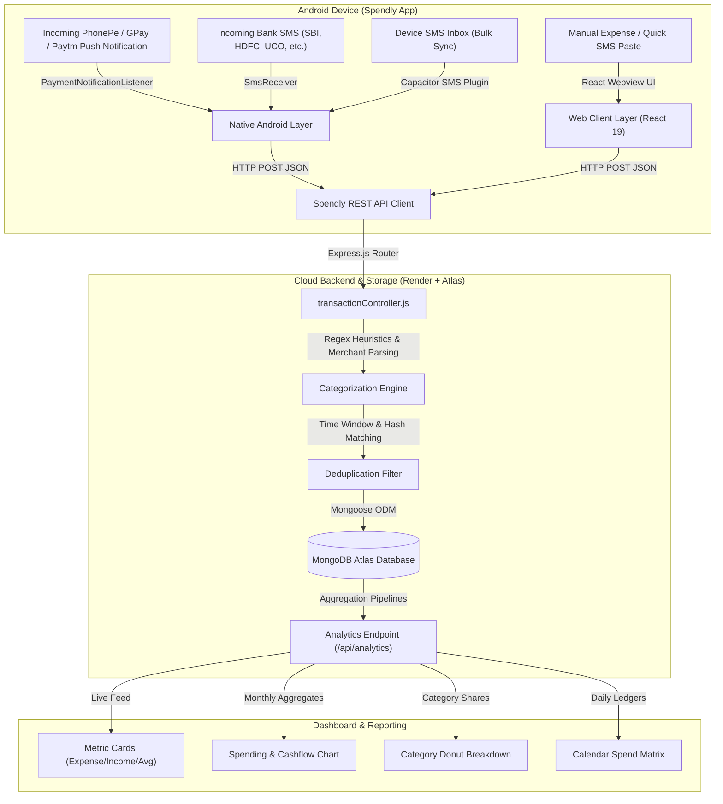

# Spendly — Smart Automated Expense & UPI Tracker

<div align="center">


[](https://spendly-kokn.onrender.com)
[](./Spendly.apk)

<br/>

[](https://react.dev/)
[](https://vite.dev/)
[](https://tailwindcss.com/)
[](https://capacitorjs.com/)
[](https://nodejs.org/)
[](https://www.mongodb.com/atlas)
[](https://spendly-kokn.onrender.com)
[](https://opensource.org/licenses/MIT)

<p align="center">
  <strong>Zero-effort, automated personal finance and UPI tracking tailored for Indian digital payments.</strong><br/>
  Interception of SMS and push notifications from PhonePe, Google Pay, Paytm, and Indian banks (UCO, SBI, HDFC, ICICI, etc.) with real-time cloud synchronization, intelligent cross-source deduplication, and an interactive financial dashboard.
</p>

[Explore Features](#-key-features) • [Architecture](#-system-architecture--data-flow) • [Tech Stack](#-technology-stack) • [Quick Start](#-getting-started) • [Android App](#-native-android-setup) • [API Docs](#-api-reference)

</div>

---

Overview

Traditional expense managers demand manual typing after every coffee, commute, or grocery bill. **Spendly** automates this entirely:

1. You tap and pay via **PhonePe**, **Google Pay**, **Paytm**, or **NetBanking**.
2. Spendly's native Android service intercepts the incoming SMS or payment notification in the background (even if the app is closed).
3. The built-in heuristic parser extracts the amount, transaction type (debit/credit), vendor/merchant, and available balance.
4. Intelligent deduplication prevents double-counting when both push notifications and bank SMS arrive for the same payment.
5. Real-time metrics and dynamic visualizations update automatically across your mobile app and desktop dashboard.

---

## Key Features

### 1. Zero-Manual Background Tracking

- **SMS BroadcastReceiver (`SmsReceiver.java`)**: Catches debit and credit alerts from Indian banks (SBI, HDFC, ICICI, UCO, Axis, PNB, etc.) instantly upon arrival.
- **Push Notification Listener (`PaymentNotificationListener.java`)**: Catches real-time payment notifications from PhonePe, Google Pay, and Paytm even if bank SMS alerts are delayed or absent.
- **Historical Device SMS Sync**: One-tap native sync reads previous financial messages from your device inbox and populates your historical expenditure timeline.

### 2. Smart Deduplication & Financial Accuracy

- **Cross-Source 10-Minute Window**: Prevents duplicate records when an app notification and a bank SMS arrive for the same purchase.
- **Credit vs. Debit Classification**: Distinguishes incoming P2P transfers (e.g., _"Money received: ₹500 from Rahul"_) as **Income**, avoiding false expenses.
- **Anti-Spam & Marketing Filter**: Automatically rejects cashback promos, lottery alerts, coupon ads, and recharge spam.
- **Cryptographic Hashing**: Unique payload hashes ensure safe batch ingestion and database integrity.

### 3. Premium Interactive Analytics & Visualizations

- **100% Real Database Analytics**: Every figure, chart, and breakdown is calculated live from MongoDB Atlas aggregation pipelines.
- **Dynamic Metric Cards**: Track Total Expenses, Total Income, Daily Average Spend, and Gateway-specific volumes.
- **Horizontally Scrollable Cashflow Chart**: Mobile-responsive bar chart showing monthly trends with auto-scroll to the current month and hover/tap expense tooltips.
- **Dynamic Category Donut**: Visual classification across Food & Dining, Shopping, Travel, Bills, Investments, and UPI transfers.
- **Spending Calendar Heatmap**: Monthly view highlighting high-spend days and net flow pills.

### 4. Cross-Platform Experience (Web + Android)

- **Fluid Hybrid Web App**: Ultra-fast responsive interface built with React 19, Tailwind CSS, and Vite.
- **Standalone Android APK**: Bundled with Capacitor 6 for native hardware access, runtime permission handling, and persistent background listeners.
- **Customizable Profile**: Persistent in-app name customization stored locally.

---

## System Architecture & Data Flow



---

## Technology Stack

| Layer                  | Technology                                                                         | Purpose                                                   |
| :--------------------- | :--------------------------------------------------------------------------------- | :-------------------------------------------------------- |
| **Frontend Framework** | [React 19](https://react.dev/) + [Vite 8](https://vite.dev/)                       | High-performance reactive user interface                  |
| **Styling & Assets**   | [Tailwind CSS 3.4](https://tailwindcss.com/) + [Lucide Icons](https://lucide.dev/) | Clean, modern neo-morphic dashboard aesthetic             |
| **Mobile Runtime**     | [Capacitor 6](https://capacitorjs.com/)                                            | Hybrid web-to-native Android runtime bridge               |
| **Native Android**     | Java, Android SDK 34                                                               | `BroadcastReceiver`, `NotificationListenerService`        |
| **Backend API**        | [Node.js](https://nodejs.org/) + [Express 5](https://expressjs.com/)               | RESTful services, deduplication, and analytics            |
| **Database**           | [MongoDB Atlas](https://www.mongodb.com/atlas) + Mongoose                          | Cloud document database with indexed transaction models   |
| **Cloud Hosting**      | [Render](https://render.com/)                                                      | Live API deployment (`https://spendly-kokn.onrender.com`) |

---

## Project Directory Structure

```text
Expense-Tracker/
├── Spendly.apk                               # Ready-to-install Android APK (~4MB)
├── Personal_Expenses_Tracker_Guide.docx       # Architecture blueprint documentation
├── README.md                                 # Project documentation
├── package.json                              # Workspace management
│
├── backend/                                  # Express.js REST API & Database Service
│   ├── config/
│   │   └── db.js                             # MongoDB Atlas connection handler
│   ├── controllers/
│   │   └── transactionController.js          # Ingestion, parsing, deduplication & analytics
│   ├── models/
│   │   └── Transaction.js                    # Mongoose schema with unique indexes
│   ├── routes/
│   │   └── transactionRoutes.js              # REST endpoints definition
│   ├── .env.example                          # Environment template
│   ├── package.json                          # Backend dependencies
│   └── server.js                             # Express entrypoint & healthcheck server
│
└── frontend/                                 # React 19 + Tailwind CSS + Capacitor Android
    ├── android/                              # Native Android Studio Gradle project
    │   └── app/src/main/
    │       ├── AndroidManifest.xml           # Android permissions & service registrations
    │       └── java/.../expensetracker/
    │           ├── MainActivity.java         # Capacitor bridge & runtime permission requests
    │           ├── SmsReceiver.java          # Background SMS broadcast listener
    │           └── PaymentNotificationListener.java # Background notification listener
    ├── src/
    │   ├── components/
    │   │   ├── AddExpenseModal.jsx           # Manual transaction entry dialog
    │   │   ├── CalendarCard.jsx              # Interactive monthly calendar with daily metrics
    │   │   ├── CategoryDonut.jsx             # Category distribution donut chart
    │   │   ├── Header.jsx                    # User profile, quick actions & sync buttons
    │   │   ├── MetricCards.jsx               # Top overview KPI cards (Expense, Income, etc.)
    │   │   ├── MobileNav.jsx                 # Bottom tab bar for mobile viewports
    │   │   ├── Sidebar.jsx                   # Collapsible desktop sidebar
    │   │   ├── SmsSyncModal.jsx              # SMS inbox sync & parser tester modal
    │   │   ├── SpendingChart.jsx             # Dynamic horizontally scrollable cashflow chart
    │   │   └── TransactionList.jsx           # Filterable live transaction ledger
    │   ├── services/
    │   │   ├── api.js                        # Axios/fetch client for backend API
    │   │   ├── parser.js                     # Indian banking & UPI regex parsing engine
    │   │   └── smsService.js                 # Capacitor native SMS reader interface
    │   ├── App.jsx                           # Root application component & global state
    │   └── main.jsx                          # React DOM entrypoint
    ├── capacitor.config.json                 # Capacitor app identifier & asset configuration
    ├── tailwind.config.js                    # Tailored color palette & theme extensions
    └── vite.config.js                        # Vite bundler & reverse proxy configuration
```

---

## Getting Started

### Prerequisites

- **Node.js**: `v18.0.0` or higher
- **npm**: `v9.0.0` or higher
- **MongoDB Atlas** account (or local MongoDB daemon)
- _(Optional for Android build)_: **Android Studio** (JBR 17+) and **Android SDK 34**

---

### 1. Backend Setup

```bash
# Navigate to the backend directory
cd backend

# Install dependencies
npm install

# Configure environment variables
cp .env.example .env
```

Edit `backend/.env` with your configuration:

```env
PORT=5000
MONGODB_URI=your_mongodb_connection_string
```

Start the backend server:

```bash
npm start
```

The server will boot at `http://localhost:5000`.

---

### 2. Frontend Setup

```bash
# In a new terminal, navigate to frontend
cd frontend

# Install dependencies
npm install
```

Configure `frontend/.env`:

```env
# Point to local server for development:
VITE_API_URL=http://localhost:5000/api

# Or point to the live cloud server:
# VITE_API_URL=https://spendly-kokn.onrender.com/api
```

Run the local Vite dev server:

```bash
npm run dev
```

Open `http://localhost:5173` in your browser.

---

## Native Android Setup

### Option 1: Quick Install (Pre-compiled APK)

Spendly includes a pre-built APK ready for immediate deployment. Connect your Android phone with **USB Debugging** enabled:

```powershell
adb install -r Spendly.apk
```

---

### Option 2: Build & Compile from Source

```powershell
cd frontend

# 1. Build the production web bundle
npm run build

# 2. Sync web assets with the native Android project
npx cap sync

# 3. Compile the debug APK using Gradle wrapper
cd android
.\gradlew.bat assembleDebug
```

The compiled APK will be generated at:  
`frontend/android/app/build/outputs/apk/debug/app-debug.apk`

---

### Option 3: Android Studio

```bash
cd frontend
npx cap open android
```

Once Android Studio opens, select your physical device or emulator and click **Run (▶)**.

---

### Android Permissions & Setup Guide

For uninterrupted background tracking:

1. **SMS Permission**: On first launch, grant permission to read SMS messages.
2. **Notification Access**: Enable **Notification Access** for Spendly in Android Settings (`Settings -> Apps -> Special App Access -> Notification Access`). This activates `PaymentNotificationListener`.
3. **Battery Optimization**: On OEM skins (MIUI, ColorOS, OxygenOS, OneUI), set Spendly's battery policy to **"Unrestricted / Don't optimize"** to prevent the OS from killing background broadcast receivers.

---

## Database Schema

Transactions are managed through Mongoose (`backend/models/Transaction.js`):

```javascript
{
  amount: { type: Number, required: true },
  type: { type: String, enum: ['expense', 'income'], required: true },
  category: {
    type: String,
    enum: [
      'Food & Dining', 'Shopping & Retail', 'Transportation',
      'Bills & Utilities', 'Entertainment', 'Health & Medical',
      'Saving & Investment', 'Salary & Income', 'UPI & Bank Transfer',
      'Other Payment'
    ],
    default: 'Other Payment'
  },
  date: { type: Date, default: Date.now },
  source: { type: String, enum: ['sms', 'notification', 'manual'], default: 'manual' },
  sender: { type: String, trim: true },
  description: { type: String, trim: true },
  hash: { type: String, unique: true, index: true }
}
```

---

## 🌐 API Reference

**Live Base URL:** `https://spendly-kokn.onrender.com`

| Method   | Endpoint                    | Description                                                 | Sample Payload / Params                                                          |
| :------- | :-------------------------- | :---------------------------------------------------------- | :------------------------------------------------------------------------------- |
| `GET`    | `/`                         | API status landing page                                     | —                                                                                |
| `GET`    | `/api/health`               | Server and database health check                            | —                                                                                |
| `GET`    | `/api/transactions`         | Fetch all transactions ordered by date descending           | `?limit=50`                                                                      |
| `POST`   | `/api/transactions`         | Ingest single transaction with auto-deduplication           | `{ amount: 250, type: "expense", category: "Food & Dining", sender: "PhonePe" }` |
| `POST`   | `/api/transactions/batch`   | Bulk insert transactions from device sync                   | `[ { amount: 120, ... }, { amount: 450, ... } ]`                                 |
| `DELETE` | `/api/transactions/:id`     | Delete a specific transaction by ID                         | —                                                                                |
| `DELETE` | `/api/transactions`         | Flush all transactions                                      | —                                                                                |
| `GET`    | `/api/analytics`            | Aggregated metrics, cashflow breakdown, and category shares | —                                                                                |
| `POST`   | `/api/transactions/cleanup` | Execute deduplication scan and spam purge                   | —                                                                                |

---

## Supported Payment Alerts & Banks

Spendly's rule engine supports all major Indian payment ecosystems:

- **Banks**: State Bank of India (SBI), HDFC Bank, ICICI Bank, UCO Bank, Axis Bank, Bank of Baroda (BOB), Punjab National Bank (PNB), Canara Bank, Kotak Mahindra.
- **UPI Apps**: PhonePe (`com.phonepe.app`), Google Pay (`com.google.android.apps.nbu.paisa.user`), Paytm (`net.one97.paytm`).
- **Currency Tokens**: `₹`, `Rs.`, `Rs`, `INR` (handles comma separations and float values).
- **Date Patterns**: `DD-MM-YYYY`, `DD/MM/YYYY`, `DD-Mon-YYYY`, `YYYY-MM-DD`.
- **Balance Extraction**: Extracts remaining balance strings (`Avl Bal Rs.XX.XX`) when provided by the bank.

---

## Roadmap

- [x] Background SMS & notification interception
- [x] Intelligent 10-minute cross-source deduplication
- [x] Real-time analytics dashboard & horizontal cashflow chart
- [x] Native Android packaging via Capacitor
- [ ] Multi-account user authentication (JWT / OAuth2)
- [ ] Category-based monthly budget limits with push warning alerts
- [ ] CSV / PDF export for tax and financial reports
- [ ] Lightweight on-device ML model for instant unrecognized merchant classification

---

## License

This project is licensed under the **MIT License**. You are free to modify, distribute, and utilize it for personal or commercial projects.
